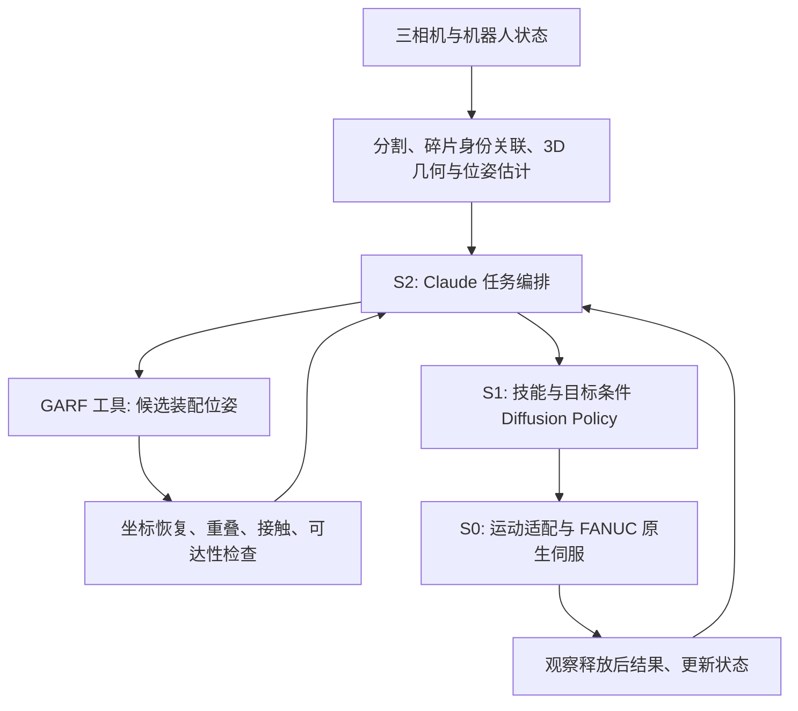

# Jing：双臂 CRAG 头骨装配

本分支以 Assembly Sim 为基础，目标是双 FANUC CRX-10iA/L + YAM 夹爪、左右腕部相机和第三视角相机，在 Isaac Sim 中装配至少六块 CRAG 头骨碎片，并用同源几何制造打印件、采集 Diffusion Policy 示范数据。

上游基线：`df03da2fc26a47d0dbf25782ec04fb6fc2ffc776`。

## 当前状态

**当前包含 CPU 几何准备、GARF 工具、S2→S1→S0 契约以及三层的代码，尚不是完整装配系统。** S0（运动学、IK、约束执行）、S1（Diffusion Policy 数据管线与模型）、S2（Claude 规划器与编排状态机）都只在 CPU 测试、合成数据和离线回放上验证过，还没有接入 Isaac 中的闭环执行。DexAgent 与 ASPIRE 两个基线已离线接入 `baselines/`，尚未实跑，没有基线成绩（见文末「基线」一节）。上游演示保持独立；没有宣称完成 YAM 适配、头骨物理装配、真实示范上的训练或真实机器人部署。

**已完成真实数据、生产推理、扩大验证集的联合微调与 PhysX 稳定性对照；尚不是完整装配系统。** 最新验证集由 2 扩到 9 个独立头骨，排除参考接触异常后，以 7 个模型/6 标本训练。固定 5000 点、小片最低预算 20→200，最佳中心误差 38.05 mm；联合分类辅助损失改善旋转，但 72 个候选仍全部被几何筛选拒绝。24 秒仿真中求解器对照使稳定碎片由 6/8 增至 7/8。详细协议、限制和图像复现见 [本轮报告](reports/2026-10-18-ablation-v2/README.md)。YAM、打印拓扑和自主装配仍待完成。

CRX-10iA/L 是用户批准的临时型号，尚未核实捐赠实机。YAM 夹爪型号已定为 I2RT `linear_4310`（10-18 用户确认），官方模型已放进仓库（见下文「YAM / 三相机 / UMI」）；CRX 法兰上的转接板、实测 TCP、相机标定、真实控制选项仍待确认。原始 CRAG 数据已从用户服务器取得，权重、数据及生成结果均存放于仓库外。

```bash
envs/asm/bin/python -B -m tasks.dual_arm_crag_skull inspect
envs/asm/bin/python -B -m tasks.dual_arm_crag_skull validate
PYTHONDONTWRITEBYTECODE=1 envs/asm/bin/python -B -m pytest -p no:cacheprovider tasks/dual_arm_crag_skull/tests core/tests
```

`envs/`、`third_party/`、`runs/` 是仓库根目录下不进 git 的工作区目录，分别放 Python 环境、上游仓库和所有运行产物，结构见根目录 README 的「Workspace layout」。

以上命令都从仓库根目录运行。旧写法 `python3 -m unittest discover -s tasks/dual_arm_crag_skull/tests` 只会发现 `test_config.py` 里 3 个 unittest 风格的测试，其余测试是 pytest 风格，会被静默跳过。

`validate` 成功只表示配置结构一致；输出明确报告 `simulator_ready: false`，不会启动机器人。配置中的空值必须被真实测量或验证结果替代，不能默认为零。

## 夹爪选择

头骨任务默认选择 **YAM**（`jing.json` 的 `workcell.gripper_family`），可用
`--gripper robotiq` 显式选择 **Robotiq 2F-85** 代理。`launch` 与 `smoke`
使用相同的选择规则；旧参数 `--allow-robotiq-proxy` 保留为 Robotiq 选择的兼容别名，
不能与 `--gripper yam` 同时使用。

YAM 的具体模型、场景适配和 TCP 标定尚未接入，因此默认 YAM 启动会明确报错。
选择 Robotiq 可运行现有代理场景：

```bash
python -m tasks.dual_arm_crag_skull launch --assembly runs/PATH/layout.json --gripper robotiq
python -m tasks.dual_arm_crag_skull.smoke --assembly runs/PATH/layout.json --output runs/smoke --gripper robotiq
```

这一选择针对头骨任务；共享 core 的现有场景资产仍为 Robotiq。

## S2 / S1 / S0 架构

| 层 | 选择 | 输入 | 输出 | 调度 |
|---|---|---|---|---|
| S2 | ASPIRE Python 程序（默认 skills，可选 direct） | 可观测场景、候选与执行反馈 | skills：技能请求；direct：CAP 运动 API | skills 随事件重跑；direct 执行冻结程序 |
| S1 | 条件 1D U-Net Diffusion Policy | 图像历史、双 TCP/开口状态、双手相对位姿、skill 与可观测目标 | 双臂末端动作块 | 滚动时域 |
| S0 | FANUC 原生伺服（实机）/ PhysX drives（仿真）+ 外部运动适配 | 动作块、机器人状态、碰撞环境 | 12 轴位置目标与两个夹爪宽度目标 | 初始仿真目标 60 Hz |
| 物理 | Isaac Sim 5.1 / PhysX（已在 5.1 做场景 smoke） | 关节驱动、接触几何、质量和材料参数 | 实际运动与接触 | 初始 240 Hz |

S2 默认与 ASPIRE 共用程序运行器，配置为 `s2.planner = aspire_program`、
`s2.execution_mode = skills`。两种执行方式：

| 模式 | 程序可用接口 | 执行路径 |
|---|---|---|
| `skills`（默认） | `get_observation`、`get_task_context`、`propose_assembly_candidates`、`submit_skill_request` | 程序 → 校验后的 SkillRequest → 编排器 → S1 → S0 |
| `direct` | ASPIRE 的 CapApi，如 `move_to_pose`、`set_gripper` | 程序 → ASPIRE CRX 适配器 → S0 检查 → AssemblyBackend |

实现见 `s2/aspire.py`。两个模式共用上游 `ToolRegistry` / `ProgramExecutor`；
`baselines/aspire/runner.py` 也调用这一入口。skills 不注册运动 API，direct 不注册技能提交接口。
skills 每次基于新 observation 执行同一份冻结程序，至多提交一个请求；目标仍从通过筛选的
候选 ID 解析，仍检查训练过的技能/手臂组合。提交后的错误或再次调用工具会使请求作废。
程序 SHA256、模式和工具调用记录在 trace；direct trial 的 artifacts 也记录模式。

`AspirePlanner` 可直接作为 `AssemblyOrchestrator` 的 planner；`build_planner(config, program_path=...)`
按配置构造。程序在加载时冻结。默认 `program_path` 为空，必须提供程序，不自动换用旧规划器。
原 Claude 工具调用规划器保留为显式的 `planner = claude_tools`（仅 skills），配置中仍保存其模型参数；
它尚未做真实 API 验证。`preview` 子命令专门预览这个旧客户端的请求。

```bash
# skills：仅输出计划，不执行机器人；示例请求重新观察。
PYTHONDONTWRITEBYTECODE=1 envs/aspire/bin/python -B -m tasks.dual_arm_crag_skull.s2 program \
  --program tasks/dual_arm_crag_skull/s2/programs/reobserve.py --observation OBSERVATION.json

# direct：使用与 ASPIRE 基线完全相同的 trial runner；目前仅有无物理测试后端。
PYTHONDONTWRITEBYTECODE=1 envs/aspire/bin/python -B -m tasks.dual_arm_crag_skull.s2 program \
  --execution-mode direct --program tasks/dual_arm_crag_skull/baselines/aspire/reference_program.py \
  --task runs/baseline_tasks/skull_base.json --seed 101 --backend kinematic \
  --output-root runs/s2_direct --max-steps 1000 --no-videos
```

第二条是调用格式示例：参考程序只在测试用高盒子上通过，真实头骨仍可能被接触阶段检查拒绝。
direct 结果记为 `method=aspire`，避免把同一条 ASPIRE 路径另算作 S1 方法成绩。
程序作者可使用 ASPIRE 的 coding-agent 工作流，但本项目尚未接通头骨任务的自动生成—试跑—修正循环。
本次统一的是程序接口和运行器。Isaac 后端已经写好并通过检验（`sim/backend.py`），但还没有接到 ASPIRE 运行器上；真实 S1 执行器和物理闭环仍待实现。
上游运行器的 AST 检查不提供进程隔离或硬墙钟超时，沿用基线的隔离运行要求。

### S0 优先使用 FANUC 原生伺服

实机链路：S1 双 TCP 动作块 → 外部双臂协调、碰撞检查、IK 与时间参数化 → ROS 2 Scaled Joint Trajectory Controller → FANUC 官方驱动 → FANUC 控制器原生伺服。底层电机控制无需重写；YAM 夹爪需要独立驱动。两台控制器的同步和互相避碰仍须由本项目实现与验证。

Isaac Sim 使用 PhysX 关节位置驱动近似执行层，不等同于 FANUC 原厂伺服模型；需要通过延迟、跟踪误差和速度限制标定缩小差异。

按 [FANUC 官方 v2.3.0 文档](https://fanuc-corporation.github.io/fanuc_driver_doc/v2.3.0/docs/quick_start/quick_start.html)，实机外部控制要求 J519 Stream Motion + R912 Remote Motion，或包含两者的 S636 软件包；还须满足相应控制器固件版本。CRX-10iA/L 在官方 MoveIt 示例支持列表中，但捐赠设备的控制器、固件及选件尚未核实。官方驱动可用并不表示实机已具备许可证。

S1 负责学习多模态的抓取和装配动作，S0 负责确定性的运动执行。第一版用位置伺服，便于对齐 FANUC 实机能力；不假设支持直接力矩控制，也不默认加入未经标定的力控。

初始基线可复用阻尼最小二乘 IK，但必须增加限位、速度、步长和碰撞拒绝；它不是完整避障规划器。目标外部运动适配器使用 12 轴联合 QP：

`min ||J qdot - v_des||_W² + λ ||qdot||²`

约束包括关节位置/速度/加速度、左右臂和环境最小距离；距离约束为局部线性近似，执行前仍需连续碰撞检查。无可行解、轨迹过期或观测超时则拒绝动作并返回结构化状态，不静默裁剪成不同任务动作。停止时不能默认松开正在支撑的碎片。

S0 做局部跟踪，不能解决全局绕障。远距离搬运需要独立的碰撞感知路径规划接口；第一阶段两臂交替进入装配区，第二阶段再做一臂支撑、一臂插入。只有在传感器、驱动能力和接触模型完成验证后，才评估 Cartesian admittance/impedance。

## S1 训练设计

采用共享或独立视觉编码器提取三相机特征，将两帧观测历史、本体状态、左右工具相对位姿、技能 ID、目标条件编码作为 conditional U-Net1D 的条件。该技能/目标条件是本项目扩展，并非原始 DP 自动具备语义规划。

初始配置：观测历史 2 步、10 Hz 动作网格、预测 16 步、执行前 4 步后重新观测。1.6 秒预测、0.4 秒执行是待调参基线；相机/推理/控制延迟必须计入执行时间戳。接触阶段可缩短执行块。

每手 3 维相对平移 + 6D 旋转 + 1 维绝对开口宽度，共 20 维。所有未来位姿相对于本次观测时该手 TCP 固定锚点，不是相邻动作增量。先把 6D 旋转正交化，再合成 SE(3)，不能把无效旋转直接下发。动作表示细节见 [接口文档](INTERFACES.md)。

训练流程（待实现）：

1. 从 CRAG GT 与配置生成脚本专家请求；专家可使用真值定位。
2. 专家必须经过同一个 S0 和 PhysX 执行，记录成功及失败，不能直接搬动物体伪造抓取。
3. 保存三相机、实际 TCP/宽度、实际关节状态、请求/接受动作、时间戳和结果。
4. 按 episode 切分训练/验证/测试，先用完整成功示范训练；失败留作评估和以后恢复技能训练。
5. 对训练集统计归一化；用噪声预测损失 `E[||epsilon - epsilon_theta(A_k, k, observation)||²]` 训练 DP。
6. 在未见过的初始摆放上闭环评估，不仅看离线 loss；额外报告抓取、单块放置、整件装配成功率与碰撞/失败分类。

数据格式、模型与训练的实现见 [s1/README.md](s1/README.md)。2026-10-18 用合成数据做了 GPU 冒烟（不是头骨任务）。审查修复后的代码用默认的确定性 DDIM-16 时，事先定好的 10 项判据有 2 项没过：搬运前撞障碍 21.7%，本应静止的手原始输出移动 2.0 cm。按预登记改用 `sampler_eta = 1`、训练加到 16000 步、换一批新数据后，这两项都通过（命中 0、2.7 mm）；但这次共享 GPU 被其他用户占满，DDIM-16 单次 315 ms，两项延迟判据没过，这个 FAIL 照旧保留。同一代码包在不争用的 torch L40S 上（作业 20232734，单独预登记）十项全过：DDIM-16 单次 52 ms，部署路径 54 ms，训练损失与 maxwell 逐值相同，说明 maxwell 上的延迟失败来自 GPU 争用。结果见 [reports/s1_smoke/README.md](reports/s1_smoke/README.md)。这还没有用到仿真专家示范。

GT 物体位姿仅供专家/评估，默认不进入 S1/S2 的正式观测。可以做明确标注的 oracle 消融。随机目标必须通过标记、目标位姿条件或可观测几何表达，不能要求策略复现隐藏随机点。

## CRAG 与可打印几何

候选样本是原演示的八块 `Hoolock-hoolock-f-AMNH-83425-cranium-einscan`。必须实际读取后校验独立 fragment ID、数量、单位和场景节点变换，不根据文件名假定八块。GT 与 CRAG 预测分别保存；用 GT 制造/评估，用预测测试推理和纠错。

新增 loader 接入现有 `FragmentInput/AssemblyInput`；在统一装配坐标系缩放并共用体素网格，解决不同碎片体素所有权冲突。检查每片六邻域面连接、最小厚度、闭合流形、无自交和非零体积；仅角/边相接的 26 邻域连接不能证明可打印性。

从同一制造几何导出 3MF 或注明毫米单位的 STL、视觉网格和可验证的碰撞近似。整体缩放、体素间距和装配间隙依夹爪开口、打印工艺及测试样件选择，当前不猜值。不沿用蓝绿演示中任意 2 mm 碰撞体缩小或高摩擦参数作为实物参数。

体素化不保证拼接稳定或存在插入路径。需要验证装配顺序、夹爪退出空间、支撑状态；若使用底座/定位销/磁铁，应同时在 CAD、仿真和任务定义中表示。先打印配合试样，再打印整套。

## YAM / 三相机 / UMI

YAM 夹爪是 I2RT `linear_4310`（产品页 i2rt.com/products/yam-gripper-1 原文是 "the 'Linear 4310' gripper in Github Readme"，行程 95 mm）。
- **资产**：`core/assets/robots/i2rt_linear_4310/` 是官方仓库 i2rt-robotics/i2rt（MIT，`120c3c8`）里未改动的 MJCF、网格和许可证，`SOURCE.json` 按 sha256 钉住，文件不一致就拒绝加载。官方没有这款夹爪单独的 URDF。
- **描述**：`core/robots/linear_4310.py` 按 MuJoCo 的约定读这份 MJCF，网格位置与 MuJoCo 自己算的逐项一致（2 µm 内，`core/tests/test_linear_4310.py`）。
  - TCP 是官方的 `grasp_site`，在两个指尖端面的中点，离安装面 144.65 mm。手指横向滑动，所以开口变化时 TCP 不动，指尖只比 TCP 多伸出 0.07 mm（Robotiq 代理是 27.8 mm）。
  - 宽度是两个指垫内侧面之间的距离：关节为 0 时两个指垫互相穿插 1.04 mm（MJCF 排除了两指之间的接触），每指 0.52 mm 时相碰，最大开口 93.96 mm。
  - 本体伸到安装面后面 10.5 mm。
- **S0**：`s0/kinematics.py` 的 `yam_model` 把夹爪装在一块**暂定的** 15 mm 转接板上，安装角度让 TCP 保持代理的约定（+x 接近方向，手指沿 y 开合）。工具盒拆成本体加转接板、两指全行程两部分。种子 101 的贴桌检验在这套几何下也是 7/7（`reports/s0_contact_yam_2026-10-18.json`）。转接板没有设计，所以 `jing.json` 的 `s0.flange_T_tcp` 仍为 null。
- **Isaac**：`sim/yam_usd.py` 用 pxr 搭出夹爪：本体和两指是三个刚体，网格只做显示，碰撞体是不可见的凸块。
  - 指尖只有最末 15 mm 是实心，往上是两根侧梁，中间是沿合拢方向完全没有材料的贯通窗口（离指端 16 mm 处 ±2 mm 宽，35 mm 处 ±9.5 mm，50 mm 处超过 ±15 mm）。碰撞体按接近方向切成 2 mm 薄片，每片按片内连通性拆开（窗口两侧各一块，不填平）。
  - 每块不超过 64 个顶点、64 个面，这是 PhysX 的 GPU 上限：超过时 PhysX 会自己简化成更小的凸包。顶点多的块先减点，误差只向内、最多 0.05 mm，不够就沿顶点中位数精确切半。本体同样处理。
  - 烹制时 PhysX 会丢掉离平面 0.7 mm 以内的点（网格自身单位），所以碰撞体按 100 倍坐标写入、再缩放 0.01，这个容差在世界里就是 7 µm。接触偏移显式设为 2 mm：自动值随形状尺寸缩小，小块会被高速手指穿透。
  - `check_yam` 用 `request_convex_collision_representation` 读回每个碰撞体烹制后的形状：704 块都有效，最多 60 个顶点，向外凸出 0，向内最多 0.083 mm（PhysX 合并近共面的面时丢点）。
  - 已知限制：离指端 57 mm 以上的手指根部截面呈 L 形，凸包会填住内角（74–80 mm 处向内多伸 48 mm）。本任务里可移动碎片最高 48 mm，指尖离桌 3 mm，碰不到。
  - 两指各挂一个滑动关节，范围从指垫相碰到全开，带线性位置驱动（刚度、阻尼、最大力、最大速度都是**暂定值**：最大力 20 N，最大速度 0.1 m/s。只有驱动时合拢速度约等于 刚度/阻尼×误差，从全开一步指令到合拢实测 1.5 m/s，会撞穿方块），两指之间不碰撞（与 MJCF 一样）；一个固定关节把本体装在法兰上。两指没有耦合，靠下发同一个目标代替 MJCF 的 1:1 约束，所以一指先碰到物体时另一指会自己继续合拢。上游给 Robotiq 用的组装代码没改，YAM 只在头骨任务里使用。
  - `sim/check_yam.py` 在 maxwell 的 Isaac 5.1 上通过（`runs/check_yam_*`，判据写在脚本里，跑之前就定好了）：两只手臂在 0、30、60、93.96 mm 四个开口下，误差都不超过 0.0003 mm；5 组构型下 PhysX 里的法兰、本体、两指尖与 S0 模型相差不到 0.001 mm 和 0.0001°；S0 的 TCP 与 PhysX 里两指垫给出的抓取点相差 0.08–0.11 mm（这个估计在网格上与官方 `grasp_site` 本来就差 0.09 mm），这一项不依赖 `flange_T_tcp` 自己的常数。FANUC 资产的关节驱动刚度极高，手臂几乎是运动学跟踪，所以这里验证的是几何和装配关系，不是夹持力或抓取。
- **单片物理抓放验收（P2）已通过**（10-19，`sim/check_grasp.py`）。在 Isaac 后端上，左臂用脚本经 S0 抓起种子 101 的一片碎片（72×56×48 mm），上提 10 cm、保持 2 s、平移 5 cm、放回、松手、撤离。
  - 最终一次（`runs/isaac_checks_20261019_024300`，三项检查都通过）：
    - 两指被碎片挡在指令宽度外 5.98 mm（夹住的是 56.41 mm，弦长 56.43 mm）；
    - 从挤压到搬运结束，相对 TCP 最大偏移 0.039 mm / 0.012°；
    - 平移误差 0.09 mm；放回后位置差 0.11 mm、高度差 0.0004 mm，并且静止；
    - 没有物理关节连到碎片，碎片一直是动态刚体；其他碎片不动；三相机有效。
  - 判据：首跑之前写定。审查发现「夹空」和「打滑」两条根本不可能失败，首跑之后收紧了。首跑的逐步日志在收紧后的判据下仍然通过。
  - 前提：S0 用测试值；转接板和夹持驱动是暂定值；位姿是仿真真值；抓取是脚本，不是 S1；只验了一片、一个种子。
  - 为此修了三处物理问题：
    - 手臂驱动只给位置目标时有 0.1 s 一阶滞后，改为速度前馈；
    - PhysX 默认凸分解让指垫每侧鼓出 1.8 mm，改为自己把指尖切成 2 mm 薄片取凸包；
    - 选抓取时只用网格顶点会把体素碎片量窄，改为密集表面采样。
  - 10-19 独立审查又查出两处，均已修：
    - 薄片凸包把手指的贯通窗口填成了实心板。我原来把它当成「0.48 mm 浅槽」，那是 12 mm 宽的方块足迹正好跨在两根侧梁上造成的误读。
    - 大多数薄片超过 PhysX 的 64 顶点上限，会被重新烹制。
    - 抓取规划改用网格算出的手指内伸量图（`sim/fingers.py`）：弦长取合拢时最先接触的宽度，TCP 平移到两指同时接触，张开宽度要让开下降途中整根手指扫过的范围。
    - `check_grasp` 的两条判据原来根本不可能失败（「夹空」和「打滑」），已收紧，附着改为结构检查。
- **还没做**：宽度-电机映射、实际夹持力与驱动参数、实测开口与 TCP、腕部相机按 YAM 重新安装（现在看不到被夹碎片）。

腕相机相对工具的安装变换必须与 UMI 手持工具尽量一致，第三视角同时在 UMI 采集中录制。

UMI 是离线手持示范来源，不是 FANUC 控制驱动。使用 UMI SLAM/标定管线恢复相机轨迹、转换到 TCP，标定开口并统一双手坐标系；标记追踪失败、时钟偏移与不确定性。导入后进行双臂可达性和碰撞回放验证。UMI 没有关节角，不补造关节数据；公共策略接口使用 TCP 与开口，机器人关节数据作为可选诊断通道。

真实 FANUC 用独立适配器对接官方 ROS 2 驱动候选，核实控制器、软件选项、频率与时间同步后再定部署频率。仿真 60 Hz 不是对实机控制速率的承诺。

## 代码改动地图

| 现有模块 | 下一步 |
|---|---|
| `core/robots/{config,builder,controls,kinematics}.py` | 参数化夹爪、挂载/TCP、增加控制适配层 |
| `core/config/presets/dual_arm.json` | 复用结构；另存实测工作台标定，不覆盖默认值 |
| `core/workcell/cameras.py` | 三路同步采集与标定加载 |
| `tasks/dual_arm_breakingbad/domain/`、`preprocessing/` | 复用数据模型/统一体素网格，新增 CRAG loader |
| `tasks/stack_sawtooth_shulker_small/collection.py` | 参考录制逻辑，但重写为双臂、三相机、N 碎片与因果时间记录 |
| 本任务后续模块 | `s2/`, `s1/`, `s0/`, `data/`, `scene/`, `manufacturing/` |

完整验收顺序见 [TODO](TODO.md)。上游已发现 `Arm` 构造参数不一致、teleop/conditions 缺失引用，必须先复现并修复，不能假定旧脚本能直接运行。

## 参考

- [Diffusion Policy](https://diffusion-policy.cs.columbia.edu/)
- [UMI](https://github.com/real-stanford/universal_manipulation_interface)
- [I2RT 夹爪与驱动](https://github.com/i2rt-robotics/i2rt)
- [FANUC 官方驱动](https://github.com/FANUC-CORPORATION/fanuc_driver)
- [CRAG](https://github.com/ai4ce/CRAG)

## GARF 作为 S2 的装配推理工具

用户指定权重：[GARF.ckpt](https://drive.google.com/file/d/1ZN0-Y2HaVe6zI7q4xUVVvhbSqKGbORfg/view)，Drive 元数据大小 573,313,422 bytes。已下载、校验 SHA256，并在官方 CUDA 环境严格加载成功。配套代码参考 [ai4ce/GARF](https://github.com/ai4ce/GARF)，其官方评估使用 `denoiser_flow_matching` 和 `ckpt_path`。GARF 与 CRAG 是不同模型，不能把该权重直接加载到 CRAG 网络。

权重由独立 GPU 推理服务加载一次。S2 调用 `propose_assembly` 工具，不接收权重张量，也不直接调用电机。以下是本项目拟定的服务接口，并非声称 GARF 原生已有 API 或置信度输出；已实现本地 JSON-lines 推理进程，网络服务与 S2 API 编排尚待接入。



1. 感知输出稳定 fragment ID 和各碎片局部点云。三路 RGB 不会自动产生有尺度的完整 3D：第一阶段采用已知扫描模型 + 视觉位姿估计，或另行实现标定多视角重建。禁止把仿真 GT 偷渡为部署感知输入。
2. S2 在初始装配、身份/几何更新、装配失败时调用 GARF。请求包含 `observation_id`、输入几何哈希、fragment IDs、点云引用、米制单位、归一化变换、anchor ID、随机种子。相同输入可以缓存，视频每帧无需重复运行。
3. 工具负责官方采样/归一化与模型推理，返回候选 `assembly_T_fragment`、模型版本、checkpoint SHA256、输入哈希、延迟与失败状态。评分由明确的几何评估器计算；未经校准的评分不称为成功概率。多候选需要显式多次采样和记录 seed。
4. 固定锚点将模型装配坐标转换为工作台坐标。约定 `A_T_B` 把 B 坐标映射到 A，则 `world_T_assembly = world_T_anchor @ inverse(assembly_T_anchor)`，且 `world_T_fragment_goal = world_T_assembly @ assembly_T_fragment`。模型归一化尺度需先恢复，不能直接把归一化平移当米。
5. 几何检查器拒绝不合理穿透、ID 缺失和无效变换；规划器检查双臂可达性、抓取与插入路径。GARF 给出目标装配形状，不负责机器人路径或先后顺序。
6. S2 选择 `pick/place/align`、操作者手臂、支撑片和目标相对位姿。S1 根据技能/目标、图像与本体状态生成双手短动作块，S0 完成限位/碰撞检查与执行。S1 必须训练这些条件，不能把新技能名称直接塞入未经相应训练的策略。
7. 每次放下后重新感知，检查相对位姿与稳定性。通过则继续；失败则重观察、重调 GARF 或安排恢复动作。超时、异常、过期 observation ID 不产生运动命令。

训练时可用 GT 生成专家动作，但 S2/GARF 的预测与 GT 必须分开记录。数据记录 GARF 输入版本、候选、检查结果、S2 技能、S1 请求动作、S0 接受动作及执行后状态。分别评估 GT 目标、GARF 目标和 GARF+S2 恢复，才能区分几何误差与控制误差。

## 当前可执行的 CPU 准备和仿真入口

安装 `requirements-cpu.txt` 到独立 Python 3.12 环境。输入必须是各节点已经处于装配 GT 坐标的 GLB，至少六个节点。下面尺寸只是调用示例，不能视为已批准的打印参数：

```bash
python -m tasks.dual_arm_crag_skull prepare \
  --input /data/skull_assembled_gt.glb --output /data/jing_prepared \
  --pitch 0.005 --target-length 0.20 --source-is-assembled-gt
# 在具备项目所需 Isaac Sim 的环境内运行：
python -m tasks.dual_arm_crag_skull launch \
  --assembly /data/jing_prepared/layout.json --allow-robotiq-proxy
```

准备步骤保留节点变换与稳定 ID，复用共同网格和唯一体素归属，保留所有占据体素，拒绝非六邻域连通/非闭合/绕向不一致的碎片；输出布局、米制 NPZ 与毫米 STL，以及源文件哈希、坐标变换和单位 manifest。当前仍为表面采样体素，不是实体体素填充；间隙为零，薄壁、插入路径和制造试样尚未验证，STL 是几何候选。

`launch` 复用双 CRX、三相机、PhysX 碎片场景，显式要求允许 Robotiq 临时代替；不声称 YAM 已实现。当前只有人工交互入口，无自动六片装配专家。CPU 合成 GLB 测试不能代替真实头骨样本与 GPU 物理抓取验证。此前 Arm(dict) 风险描述属于历史待复核项，不能认定当前重构后的代码仍存在该错误。

## 运行 GARF tool 与 RGB-D 接口

已实现 `tools.garf.GarfTool`、Anthropic 风格 tool schema、JSON-lines runner；GPU 模型加载一次，支持单 seed 和 1–8 个 seed 候选。完整点云与法向量以 NPZ 注册，S2 只提交 ID，不能提交任意文件路径。输出候选不直接触发运动。

官方 GARF 依赖在独立目录执行 `uv sync --extra post`；固定源码 commit `2d489c0b7b58de8af774aa1657c86c638e4744c2`。权重 SHA256：`cc6512ab48818b902bc1a7a0b4c569e049dbd6633c62cfff3de0890715825e02`。使用严格 state_dict 匹配和受限 checkpoint 加载，只允许核对过的 OmegaConf 元数据类型。

```bash
python -m tasks.dual_arm_crag_skull.tools \
  --repository /data/GARF --checkpoint /data/GARF.ckpt \
  --geometry /data/points/registry.json \
  --mesh-registry /data/points/mesh_registry.json \
  --model-unit-m 0.20749005075939986 < /data/request.jsonl
```

注册表为 `{"part_0":"/data/part_0.npz", ...}`，NPZ 包含米制 `points: Nx3` 与 `normals: Nx3`。单行请求例子：

```json
{"tool_name":"propose_assembly_candidates","current_observation_id":"obs-10","request":{"observation_id":"obs-10","fragment_ids":["part_0","part_1"],"anchor_id":"part_0","seeds":[41,42,43,44]}}
```

`current_observation_id` 由编排器提供；S2 的 observation_id 不一致则拒绝。固定几何抽样，只改变初始噪声；默认 20 步、6 次迭代。大批推理仍应由外部进程施加超时与资源限制。

用户提供每个 part 的完整点云后，可以省去完整几何重建，但不能省去 RGB-D 中的实例识别和当前位姿估计。见 [接口文档](INTERFACES.md) 的反投影、ICP、锚点恢复公式，以及“已装好碎片融合为一个刚体”的逐步推理接口。

真实资产来源已定位到 maxwell 的 `data/fanuc_crag_skull_assembly/01_crag_case/view_gt.glb`，确认为八片 Hoolock 头骨。原 bundle README 明确旧影片是运动学 storyboard，不能当物理抓取验证。新的 `smoke.py` 在 Isaac Sim 5.1 执行物理步进并在暂停的同一时刻采集三路 RGB、光学 Z depth、内外参；仍不表示完成抓取装配。

```bash
python -m tasks.dual_arm_crag_skull prepare \
  --input /data/view_gt.glb --output /data/skull_diagnostic \
  --pitch .008 --target-length .2 --source-is-assembled-gt \
  --simulation-only --allow-disconnected-rigid-proxy
python -m tasks.dual_arm_crag_skull.smoke \
  --assembly /data/skull_diagnostic/layout.json --output /data/smoke \
  --allow-robotiq-proxy
```

该诊断模式保留所有体素，把不连通分量作为一个刚体近似，并明确写入 manifest；不导出 STL，不适合打印或装配验收。可选单格补桥保持全部原体素并避免侵占其他片，但在本次头骨上未解决全部断裂，因此没有用于上述运行。

可选 `--straight-assembly-anchor ID`（`interlock_repair.py`）：8 mm 体素的相邻碎片在接缝处互相勾住，锚点固定时红、绿、青、橙沿任何直线都放不进去（`experiments/assembly_paths.py`）。该选项只改接缝处体素的归属，不增删体素，使锚点固定时每片都能按某个顺序沿坐标轴直线插入；改后各片连通，因此不再需要 `--allow-disconnected-rigid-proxy`。最后，活动碎片中游离的立方体会交给相邻碎片，前提是不挡装配顺序。修复结果写在 manifest 与 layout 的 `ownership_repair` 里，包括装配顺序、每片的方向、翻转格数和处理掉的孤立块。本头骨上试了两个候选：

- 以红（底座）为锚点，62 格换了归属，白（头盖）最后从上方盖上，7 片中 5 片从上方放入；方向不变时有 36 种顺序能直线放入，在 Isaac 里每一种都不会在重力下移动（见 `baselines/README.md`）；
- 以白为锚点，106 格换了归属，7 片全部水平插入。

`--assembly-order ID,...` 给出装配顺序（不含锚点），用修复给出的方向在体素格上精确判定能直线放入才接受，写进 `ownership_repair.plan`；不给时用修复自己的顺序。10-20 用户选红作锚点，并决定装配计划是 GT 的一部分、所有方法都给：任务几何换成 `runs/skull_red_plan/`，与 `runs/skull_straight_red/` 的网格逐字节相同，只多了计划，顺序取 橙、蓝、绿、黄、青、品红、白，在 Isaac 和 MuJoCo 里逐片放下时每一步都不动。任务在 `runs/baseline_tasks/`（见文末「基线」）。白锚点候选留在 `runs/skull_straight/`。输出目录须在仓库外，再移入 `runs/`。原 FANUC 资产还触发部分 link 的质量/惯量警告，动力学可信度须另行校准。

## 2026-10-14 实测结果

[机器可读报告](reports/2026-10-14.json) 记录八片真实头骨、权重哈希、四噪声候选和三相机数据。GPU 上固定几何采样，使用 20 步 × 6 次迭代：

| noise seed | 推理秒数（不含加载） | 非锚点平均平移误差 | 非锚点平均旋转误差 |
|---|---:|---:|---:|
| 41 | 3.57 | 58.9 mm | 101.3° |
| 42 | 2.28 | 46.6 mm | 124.4° |
| 43 | 2.16 | 47.8 mm | 118.9° |
| 44 | 1.77 | 57.6 mm | 123.7° |

误差用独立 GT 作锚点对齐，只用于离线评估。当前候选显著不足以直接装配；多噪声调用确实得到不同候选，但这四次结果没有证明精度足够。下一步应对齐官方数据预处理、检查法向/归一化、评估更大点数、多候选几何筛选及头骨域适配。不得把 oracle 最优候选作为部署成功率。

物理诊断场景已跑 120 次 world.step（约 4.05 s），三路 RGB-D 采样时间一致；这是场景/传感器 smoke test，尚无抓取或自动装配成功结果。

## GARF 官方流程审计与候选拒绝

详见 [2026-10-14 审计报告](reports/garf_audit/README.md)：官方预处理仍未恢复真实头骨；固定采样与密集采样均失败，坐标回代误差约 1e-8 m。官方瓶子对照能恢复多数碎片，但不能证明头骨精度达标。

`export_points` 现在额外输出同局部坐标的 PLY 和 `mesh_registry.json`；JSONL 工具加 `--mesh-registry PATH` 可执行不依赖 GT 的穿透/接触筛选。无合格候选时明确返回 `all_candidates_rejected`；几何评分不授权机器人运动。原有四个 noise 候选全部拒绝。理想两片合并实验也没有恢复剩余六片的装配精度，不能作为自动安装成功。

本轮另修复了多候选随机性混杂：PointTransformer 在 eval 模式仍随机打乱序列，且固定 seed 后重复编码也未保证相同指纹。现在同一批几何只编码一次，缓存按几何内容失效；四个候选已验证共享相同特征，平均位置误差仍约52–60 mm。该修复保证实验可比性，不代表头骨装配精度已解决。

## 2026-10-18 进展：S0/S1/S2 代码、相机内参更正与上游修复

本轮基于 origin/jing `707223c`，所有结论都来自 CPU 测试、合成数据、离线回放或下面列出的 GPU 运行。系统仍未在 Isaac 中闭环执行，也没有在真实示范上训练。

| 模块 | 内容 | 验证 |
|---|---|---|
| `contracts/` | ActionChunk（20D 双 TCP、时效与观测年龄、非活动臂保持）和 SkillRequest（技能表、目标来源、完成判据、support 规则） | 单元测试；关键检查经变异验证 |
| `s0/` | CRX 运动学（probe 关节帧，`configs/crx10ial_kinematics.json`）、雅可比、拒绝式 DLS IK、动作块→60 Hz 关节轨迹、制动轨迹、胶囊体与夹爪包围盒检查、盒约束速度 QP | FK 对 Isaac 参考位姿最大 0.093 mm / 0.0089°；单元测试与变异检查 |
| `s1/` | Episode 格式与数据集、conditional U-Net1D Diffusion Policy（原生 DDPM/DDIM、EMA）、训练 CLI、预测→ActionChunk、运行时 | 单元测试与变异检查；合成数据 GPU 冒烟：v4 未过 C3/C10，v5（eta=1、16000 步）在被占满的共享 GPU 上只有延迟两项未过，在不争用的 torch L40S 上十项全过（`reports/s1_smoke/README.md`） |
| `s2/` | Claude 规划器、候选簿、GARF 进程客户端、编排状态机（可按 S1 训练过的 (skill, arms) 组合把关）、`preview` 命令 | 假模型客户端测试；跨层测试接真实 S0；变异检查；真实 API 调用尚未做 |
| `camera_calibration.py`、`smoke.py` | 渲染器投影矩阵求内参、深度拟合交叉验证、渲染器外参、失败退出码 | Isaac Sim 5.1 实测（见下） |
| `baselines/` | 所有方法共用的任务定义、种子初始条件与三段种子、评分与运行记录、仿真后端接口；ASPIRE 适配（补丁、CRX 适配器、逐命令 S0 检查）；DexAgent 适配（原生机器人、只跑 Stage 3、我们构造的输入、带美元上限的模型中转） | 单元与集成测试、变异检查；只在运动学替身和 DexAgent 的 mock LLM 上跑通，没有基线成绩 |

测试：从仓库根目录运行 `envs/asm/bin/python -B -m pytest -p no:cacheprovider tasks/dual_arm_crag_skull/tests core/tests`。`envs/asm` 按 `requirements-cpu.txt` 安装，安装任何包时都要钉住 `numpy==1.26.4`。

**相机内参更正。** 10-14 报告中的 fy 偏大 2.782%。相机只设了焦距，USD 胶片背保持默认 20.955 × 15.2908 mm，而渲染器按 1920×1440 的宽高比使用方像素。实测 render product 投影矩阵给出 fx = fy（agent 2290.6228，腕相机 1649.2485），同帧光学 Z 与射线距离的拟合与之相差 ≤ 5e-7。K 现在采用 OpenCV 像素中心约定（cx = 959.5，cy = 719.5），外参取渲染器 view 矩阵。证据：`reports/2026-10-18_camera_intrinsics.json`。

**smoke 静默失败已修。** 旧版把 `app.close()` 放在 `finally`。在 Isaac Sim 5.1 上中途强制抛异常，进程以退出码 0 结束，日志里没有 traceback，只剩一张 agent.png。新版先写 `smoke_failed.json` 并打印 `SMOKE FAIL`，再以退出码 1 结束；`smoke.json` 最后写入，它存在即表示通过。两种情况都已实测。

**S0 回放旧故事板。** `04_intermediate/choreo.json` 两侧都没有超关节限位。但右臂有 42 帧超过资产声明的关节速度，最坏是 J6 −13.68 rad/s，为上限的 4.36 倍；两臂胶囊体最小间隙 0.128 m。按原速执行会被 S0 拒绝，若要拿它做专家示范需要重新定时。

**真实 GARF 候选的几何筛选（为 S2 实测准备的场景数据）。** 用 `export_points` 重新导出的局部坐标与 10-14 记录的候选逐位一致（重算误差与报告相同）。缓存特征后的 4 个真实候选，每片 128 个采样：seed 44/42/41/43 的最大穿透比例为 11.7% / 14.8% / 25.0% / 94.5%，全部拒绝。作对照的 GT 位姿候选 0 穿透、接触图连通，通过筛选。CPU 用时 27.7 分钟，峰值 RSS 15.8 GB。

**上游问题。** `Arm`/`Gripper` 现在接受路径或已加载的映射，修复了 `teleop.py:40` 传 dict 时的 `TypeError`。small shulker 的 `config.py` 从一个从未存在的模块导入，改为本任务内导入后 5 项失败恢复。`core.robots.teleop`（`CartesianInput`、`KeyboardSubscription`）在全部历史中都不存在，`teleop.py`/`scripted.py` 仍无法导入，需要原作者补回实现。

**独立代码审查。** 第一轮审查给出 Block：6 条 HIGH 都是文档承诺的安全性质在代码里没有落实，另有 13 条 MEDIUM/LOW，全部修复，每条都补了能失败的测试。主要包括：编排器在执行前重新校验并限制规划时长；失败计数不再被 reobserve 清零；合并已验证簇的条件更严格；GARF 客户端能检测并恢复 stdout 失步，超时时杀掉整个进程组；S0 拒绝时给出可执行的制动轨迹；桌面检查纳入夹爪包围盒；校验 anchor 与观测时刻 TCP 的一致性；拒绝重放的动作块；S0 自行限制观测年龄；修正内参的半像素约定；按 fallback 规则回填历史。

**S1 冒烟（合成数据，不是头骨任务）。** 最早两次 torch L40S 作业（20219996、20221507）用的是审查前的代码和更简单的合成数据，已作废。审查修复后的合成数据改为：每个 episode 随机用左臂或右臂，两块外观相同的碎片，分 pick/place/retreat 三段；判据 v3 在运行前写定。v4（maxwell 共享 GPU，确定性 DDIM-16，训练 8000 步）未过 C3、C10：开始搬运前的采样轨迹撞障碍 21.7%（上限 15%），本应静止的手在原始输出里移动 2.0 cm（上限 1 cm，部署时会被覆盖为精确保持）。事后诊断指向确定性采样器。v5 按预登记只改配置（eta 0→1、训练 16000 步、换新数据种子），这两项大幅通过：命中 0，30/30 个 episode 都出现两种绕行模式，静止手 2.7 mm，pick 240/240 次选对碎片。但 GPU5 全程被其他用户占到 99–100%，DDIM-16 单次 315 ms（预算 100 ms），部署路径 395 ms，超过 250 ms 的有效期，所以 C5、C6 不过。与 eta 无关的 DDPM-100 也慢了 5.8 倍，延迟失败很可能来自争用，但判定仍记 FAIL。同一代码包（20 个文件逐一核对 sha256）随后在不争用的 torch L40S 上运行（20232734，运行前另写预登记），十项全过：DDIM-16 中位 52.2 ms，部署路径 53.5 ms，64 个块全部可执行；训练损失曲线与 maxwell 逐值相同，228 个评估数值前 13 位有效数字一致，只有延迟不同，这证实了争用是原因。v4 包在 L40S 上（20226851）同样 C3、C10 不过，数值与 maxwell 相同，说明 v4 的失败属于那套配置，与硬件无关。图像只有 32×32，没有用预训练编码器。

**仍待完成**：S1 在仿真专家示范上的训练、Isaac 中的 S1/S0 执行器与放手后核验器、YAM 型号与标定、关节加速度上限等 S0 参数（`jing.json` 中为 null）、连续碰撞与单臂自碰撞、可打印几何修复、基线实跑所需的 Isaac 后端与 S0 接触阶段（见下一节），以及 GARF 在真实头骨上的精度问题（另一路审计）。

## 基线：DexAgent 与 ASPIRE（离线接入，尚未实跑；2026-10-20 更新）

两个外部方法作为基线接入 `baselines/`，与我们的 S2/S1/S0 使用同一份任务、同一套种子和同一个评分。英文细节见 [`baselines/README.md`](baselines/README.md)、[`baselines/aspire/README.md`](baselines/aspire/README.md) 和 [`baselines/dexagent/README.md`](baselines/dexagent/README.md)。**目前没有任何基线成绩**：两个基线都没有调用过模型 API，ASPIRE 的学习循环没有运行。Isaac 后端已写好（`sim/backend.py`）：ASPIRE 的手写参考程序在上面跑过，DexAgent 的一条脚本交付也经 S0 在上面执行过，两者都不是基线成绩。

- **任务**（10-20 起）：
  - 几何是红锚点修复版 `runs/skull_red_plan/`，任务在 `runs/baseline_tasks/`（基础任务和种子 101），任务 id `view_gt-00f0cc2853e9-anchor-fragment_038755611176a8c9`。
  - 旧任务（未修复的诊断几何、白锚点）归档在 `runs/baseline_tasks_diag_white/`，新协议下会被拒。
  - **装配计划是 GT 的一部分，所有方法都给**（`baselines.assembly_plan = "given"`）：
    - 顺序：橙 → 蓝 → 绿 → 黄 → 青 → 品红 → 白；
    - 每片最后一段沿插入方向直线进入：5 片从上方放下，橙沿 +y、青沿 −x 水平推入。
  - 计划来自 layout 的 `ownership_repair.plan`，prepare 时已在体素格上精确判定能直线放入，建任务时还会在 layout 自己的体素格上再判一次。`AssemblyTask.assembly_plan` 给出世界坐标系里的插入方向，`verify_task` 拒绝没有计划的任务。
  - 方向不变时有 36 种顺序能直线放入。逐片放到目标位、静置到不动：
    - 评分用的 Isaac 里，36 种顺序的每一步都不动，最大 0.0004 mm / 0.0007°（`experiments/assembly_settle_isaac.py`）；
    - MuJoCo 里（机器人停在初始姿态）也都在容差内，只有先放蓝、后放橙时，蓝会滑 1.9 mm（`experiments/assembly_settle.py`）；
    - 所以顺序只受碰撞约束；计划取的是两个引擎里每一步都不动的一种。
  - 按计划逐片放入的 Isaac 回放（`experiments/assembly_replay_isaac.py`）：每片运动学搬运、碰撞开着、沿插入方向慢慢直线进入，松手后静置 1 s；7 步后所有已放碎片最大漂移 0.0003 mm / 0.0005°。视频和逐步截图在 `runs/assembly_paths/replay_red_plan_isaac/`。
  - **脚本化参考装配（10-20，我们自己的标准答案，不是基线；Isaac 上还没通过）**：`sim/assemble.py` 让双 CRX + YAM 按计划逐片抓取、搬运、沿插入方向直线放入，每一段都经 S0；`sim/check_assembly.py` 在 Isaac 上运行、录像、记遥测，`s0_margins` 用 S0 自己的几何算出这次装配用掉了各项 S0 值的多少（最终 S0 参数表的依据）。
    - 规划：抓取线先过碎片重心正上方，再左右各偏 4–16 mm；抓取高度从最高处往下试，弦长至少 15 mm；先按目标朝向找抓取（碎片倒着躺时斜着抓，到目标处夹爪竖直），不行再从正上方抓；插入从已放碎片外 20 mm 开始，夹爪和被搬的碎片下放时都不得碰到已放碎片；松手只张到刚好越过碎片、每侧加 3 mm，且不小于手指当时的实际开口；取件、开始插入、目标、后退四处按 S0 的桌面规则留 3 mm 余量；每个候选先完整预演（所有分段经 S0，关节运动对碎片扫掠），每步最多 16 个。
    - CPU（运动学后端、TEST 限值）上按 GT 计划 7/7，S0 全部放行、判定成功、最大漂移 0.10 mm：从任务给的起始位姿和从 Isaac 复位后倒下的位姿出发都可以。
    - Isaac（种子 101、GT 计划，`runs/scripted_assembly/plan_101_20261020_202436`）：S0 放行了每一段，没有碎片再被带走；但放下的 4 片偏离目标 8–12 mm，右臂后 3 片没抓住（青紧挨着白摆放、手指下去被挡；品红；白是穹顶，在顶部斜面上夹，一提就滑）。跟踪误差左臂最大 1.9 mrad、右臂 0.4 mrad。
    - 之后加了插入前按观测位姿修正爪中位姿（插入起点再读一次、先对准再插入），遥测记录每个碎片的位姿：碎片到插入起点时误差 0.1 mm，偏差全出在零间隙插入上；接缝留 1 mm（上面的协议）后，橙、蓝都放到 1 mm 以内（`runs/scripted_assembly/plan_101_protocol_inset_20261020_223731`）。绿那一轮没抓住（倒伏后斜抓落空），还在查。
    - ⚠️ 前两次 Isaac 运行里碎片被夹走，是规划循环的变量遮蔽 bug（插入起点用成了抓取线的横向偏移）；已修，并补了被搬碎片下放的检查。先前（10-20 下午）以为「GT 顺序橙先放蓝放不进」「从倒下的位姿蓝无解」也是规划器每个偏航只搜中线一条抓取线造成的，已作废。
    - 起始位姿立不住：蓝、绿、黄、白的质心在支撑面外 13、8、11、20 mm，Isaac 复位时倒 18°、47°、35°、5°。按 10-19 的决定（见 TODO），应改为稳定摆放、所有方法用同一套落定后的初始条件；还没实施。
    - **抓取的选择（10-21 下午，Isaac 上逐片查出来的）**：`GRASP_TIERS` 分档搜索，同一档里再按高度、偏移、手臂找：
      - 线离重心 ≤ 8 mm（`CENTRED_M`）的优先：品红偏 16 mm 时，一抬就绕闭合轴甩出去（挤压加到 18 N 也只放到 7.4 mm）；改用过重心、接触只有 5.3 mm 的抓取，放到 0.8 mm / 1.5°；
      - 沿体素网格闭合的优先，其次偏 5° 以内，偏得更多的最后：斜着夹时，碎片会自己转到贴平指垫，青偏 13.7° 就转了 13.2–13.8°（与挤压力无关），超过 10° 的修正上限；
      - 两侧接触 ≥8 mm 的优先于更少的；
      - 夹爪对称，TCP 绕接近轴转 180° 是同一个抓取，取件、目标等各位姿两种朝向都试（以前只用取件时先解出来的那个，右臂沿青的网格的抓取因此在目标位解不出来）；
      - 一只手臂伸到对侧时，另一只先绕底座转开 60°（`RETREAT_TURN_RAD`）：停在初始位时它正好悬在本侧的碎片上方。
    - Isaac 从第 1 步跑完整装配（`runs/scripted_assembly/full_rule_on_20261021_144051`、`full_rule_off_…`）：橙 0.50 mm / 0.00°、蓝 0.51 / 0.06、绿 0.53 / 0.26、黄 0.70 / 0.13、青 0.65 / 1.82，全在容差内。品红插入时被「手指撑开」停机规则拦下；关掉规则则放到 2.06 mm / 2.37°，但把青挤到 3.17°。白的抓取仍然落空。
    - 「手指撑开」停机规则和不联动的两指冲突：Isaac 两指原来不耦合，插入时碎片被侧推，一根手指被推出 2–3.5 mm，张开量（spans）超出 S0 的界 4.7–7 mm，两指间隙只变 0.6–0.8 mm。之前说「正常运行最多撑开 1.15 mm、不会误停」量的是间隙，不是张开量，这个依据是错的。DexAgent 用的 MuJoCo 夹爪也没有联动（之前说它和官方 MJCF 一样有等式约束，是错的）。
    - **10-21 用户定「A」：两指联动，和真实 YAM 一样。**
      - Isaac（`sim/yam_usd.py`）：tip_right 用 PhysX 的 mimic 关节跟随 tip_left（实例名只能是 rotX/rotY/rotZ，写 transZ 会被静默忽略）；两指都保留各自的驱动；整条手臂的位置迭代提到至少 64（32 次时，两个指垫各差 0.25 mm 才停）。`sim/check_yam.py` 加了联动检验：方块偏中 5 mm 时，近的一指先碰到，两指一起停，开口比方块宽 10 mm；实测 49.95 mm，预测 50 mm。两个指垫离方块面合计 0.025 mm（32 次迭代时合计 0.5 mm），PASS。偏中方块的结果和偏 1 mm 同侧的方块对比来判，TCP 偏差在两者里相同，可以抵消。
      - MuJoCo（`baselines/dexagent/bench/yam.py`）：加了官方 MJCF 那条等式约束（`<side>_fingers_coupled`，index 跟随 thumb），硬度和接触一样（solref 0.005，solimp 0.99/0.999）。照抄官方的默认硬度不行：默认硬度按质量归一，71 g 的手指顶不住 20 N 的伺服力，两指行程差 9.9 mm，和没联动一样；改用接触的硬度后差 0.13 mm。DexAgent 用 `MjSpec.attach` 拼手、`compile_rigid` 去掉手腕焊接时，这条约束都保留。旧的 DexAgent 导出没有这条约束，要重新导出（接缝改了，本来也要重导）。
      - Isaac 完整运行（`runs/scripted_assembly/coupled_rule_{on,off}_20261021_152250`）：
        - 前五片都在容差内：橙 0.53 mm / 0.01°，蓝 0.51 / 0.03，绿 0.54 / 0.01，黄 0.53 / 0.00，青 0.65 / 1.75。
        - 张开量和间隙之差 ≤ 0.004 mm。前五片的每段运动里，张开量最多超出指令 0.02 mm（不联动时 0.44 mm）。
        - 品红插入时，碎片把联动的两指撬开 7 mm，是真卡住了：联动的两指，侧向力要超过两倍夹持力才撬得开。规则开着时，在超出 3.9 mm 处停机。关掉规则时，品红放到 2.13 mm / 2.88°，但把青挤到 3.67°、蓝挤到 2.94°。剩下的是品红的插入路径问题，不是规则误停。
    - S0 的指盒原来按全行程算（闭合方向 ±70.8 mm，40 mm 的夹取实际只到约 ±31 mm）：夹爪一倾斜，盒角就下沉 17–35 mm，近桌面的斜抓常被拒。**10-21 用户定「A」：S0 的盒子按开口算，所有方法同时生效。**
      - 规则：`S0Limits.finger_opening_margin_m` 设了值时，S0 取这段运动里夹爪可能的最大开口（实测开口、上一次指令、本段每个新指令三者取最大，`s0.adapter.widest_opening`），加上这个余量，再按这个开口取工具盒和指盒；不设时照旧按全行程。TEST 值 4 mm：留 1 mm 接缝后的 Isaac 脚本运行里，指令保持不变的一段运动中手指最多被撑开 1.15 mm（品红被撞那次；量的是间隙，当时两指不联动，张开量更大），松手超调不超过 0.05 mm；留缝之前碎片卡死时手指被撬开过 6–12 mm，这种情况余量盖不住（S0 只在每段开头读开口），真实夹爪的开口也还没标定。实测开口按 `RobotSnapshot.spans` 取：按张得更远的那根手指算（2×max(q左, q右)+闭合间隙）。两指联动后（10-21），这就等于间隙。两指联动、0.5 mm 接缝时，正常运动中张开量最多超出指令 0.02 mm；品红插入卡住时被撬开 7 mm。
      - 手指几何（`s0.kinematics.yam_tool_geometry` 的 `fingers.stroke`）：每根手指沿接近方向每 5 mm 切一段，每段一个盒子（三角面在切面处裁开，每个盒子包住该段的全部表面）；按开口取盒时，每段从闭合扫到该开口。只用一个盒子不够：手指根部的滑块比指尖宽 17 mm，一个盒子会把根部的宽度也算到指尖那端。按绿片在 Isaac 落定后的姿态算：151 个被拒的斜抓，按开口取单个盒子仍一个都过不了（最低点 −32 到 +4 mm），切段后有 27 个能过（切到 2 mm 的极限是 29 个）。
      - 各方法怎么拿到开口：我们 S1 的 `S0Adapter` 用实测、上次指令和块内宽度；ASPIRE 适配层用快照实测、上次指令和命令里的宽度；DexAgent 执行器同样（它的 S0 预检回放在录制里手指比指令宽时按录制的开口算）；脚本参考的预演认为夹住碎片后手指停在弦长。ASPIRE 适配层判断「是否在接触带里」（决定能否声明、撤销接触窗）用的是 S0 自己的规则和同样的开口。仍按全行程盒子的只有 ASPIRE 的接触限速和 DexAgent 规划器的接触带：只会更慢，不影响 S0 是否放行。DexAgent 的 S0 规格升到 v3，旧规格（没有余量这一项、会按旧 S0 执行）一律拒绝，要重新准备。
  - **更正（10-20）**：之前说「只有 6 种顺序稳定，其余会把青压歪 3.9 mm / 6.3°」，这是早先的 MuJoCo 检查让机器人从 qpos0 起步造成的：那时机器人的手在头骨里、压进桌面，虽然没碰任何碎片，青还是歪了；机器人改从初始姿态起步后，就不再出现。
- **公共层**：
  - `AssemblyTask`：来自真实 8 片头骨布局，锚点从目标位姿开始，其余碎片从摆放区开始；
  - 每个种子的初始条件：平移 ≤ 3 cm、偏航 ≤ 30°，互不重叠；
  - 种子三段：练习 101–125、挑选 126–130、留出 1–100（暂定）；
  - `score_assembly`：用仿真真值，相对锚点判定，容差取 place 的 3 mm / 3°，缺失或非有限的位姿判失败；
  - `RunRecord`：记录费用、调用次数、耗时和仿真次数，按 Wilson 区间统计；
  - 仿真后端接口 `AssemblyBackend`，加上测试用的 `KinematicBackend` 和 Isaac 后端；
  - S0 的 `check_joint_path`：非有限的实测状态直接拒绝；加速度按相邻两段速度之差除以平均间隔，第一段的「前一段」是后端声明的实测速度平均窗口（10-19 统一口径）；末端必须能在限位内制动；
  - 保护性停机（10-19）：某关节连续 3 个周期偏离指令超过 10 mrad，或超过最大速度的 1.1 倍，试验就此结束，记为失败，不评分。10-21 用户加了一条（`finger_reach`）：手指张开（`RobotSnapshot.spans`）超过 S0 为这段运动所取的开口加余量，也停机。各方法在 S0 接受一段运动后、执行前，用 `AssemblyBackend.bound_reach` 把这个界交给后端；DexAgent 的 S0 预检回放同样检查。依据：S0 只在每段开头读开口，留缝前碎片卡在指间时把手指撬开过 6–12 mm。两指联动后（10-21），正常运动中张开量最多超出指令 0.02 mm，不会误停；品红插入卡住时被撬开 7 mm，规则在此停机。
  - 协议（种子分段、摆放参数、成功判据、锚点夹具、装配计划、接缝间隙）固定为 `jing.json`，每次试验前都从 layout 重建任务核对。
  - **侧面接缝 0.5 mm、上下层之间 0.2 mm**（10-20 用户决定留缝，当时 1 mm；10-21 改为 0.5 mm；10-22 用户定竖直方向每面 0.1 mm，`baselines.collider_inset_m` = 水平 0.25 mm、竖直 0.1 mm）：每片碎片的碰撞盒，在它目标位上朝侧面的面比体素格小 0.25 mm，朝上、朝下的面小 0.1 mm。Isaac 后端的碰撞盒和 DexAgent 导出的 MJCF 碰撞盒都按这两个值内缩（`baselines.task.box_axis_insets`：看盒子哪根轴在碎片目标位上是竖直的）；显示用的网格、体素格、目标位姿和装配计划不变。磁盘上已有的 DexAgent 导出都早于协议的内缩（碰撞盒没有内缩），要重导。依据：
    - 零间隙时，脚本化参考装配已经把碎片送到插入起点、误差 0.1 mm，插入照样卡住（橙转 35°，蓝停在高一个体素处）；
    - 留 1 mm 后插入不再卡，但叠在碎片上的碎片每层下沉 1 mm，青（一边在蓝上、一边在红上）放好后自己倾斜 3.8°，挡住下一片的插入（Isaac：把计划的每个前缀摆到目标位后静置）；
    - 留 0.5 mm 时每个前缀最多 0.96 mm / 1.9°；只缩水平面虽然只有 0.03°，但青横向插入时被卡住、转了 21°；
    - 侧面 0.25 mm 时，叠在碎片上的碎片静置倾角和竖直缩进成正比：青（没有机器人）在竖直缩进 0.05 / 0.1 / 0.15 / 0.25 mm 时歪 0.36° / 0.71° / 1.06° / 1.76°，约 7.1°/mm（`runs/scripted_assembly/settle_inset`）。品红插入时悬出部分压在青上：青 ≤ 0.71° 的 6 次运行品红都进去了，≥ 1.06° 的 7 次只进去 1 次。竖直缩进为 0 时橙插不到位（差 25.6 mm），所以取 0.1 mm。这些运行大多用了指尖实心段单凸块（实验补丁，待定）；用 `sim/yam_usd.py` 现在的 2 mm 薄片指尖，参考装配在新协议下第一步橙就在手里转了 31°。`exp_aniso_*` / `exp_padhull_*` 报告里的 `collider_inset_m` 记的是 0.00025（补丁没改记录），以目录名为准；
    - 打印出来的碎片本来也有间隙。
  - 评分前所有方法统一收尾：两爪张开，静置 1 s。
  - 留出种子在试验前原子占用，同一变体在同一任务的同一种子上只跑一次；中途崩溃或被中断也记为 `error`，换记录文件也不能重跑。
  - 公共层做过一次独立审查（4 个高危、6 个中等问题），全部修复并补了测试。
- **ASPIRE**（NVlabs，Apache-2.0，`fa00f0e`）：
  - 一个补丁（3 个文件，+11/−2 行），注册 6 轴 `fanuc_crx`、我们的 IK `crx_dls` 和两个接触工具；
  - 适配器把双 CRX 工作台接到 ASPIRE 的 `EnvironmentAdapter`，每条关节命令先过 S0 检查，被拒时什么都不动；
  - 贴桌抓放前，程序用 `fanuc_crx.declare_contact` 声明接触，只能报碎片 ID，窗口由适配器按观测位姿或目标位姿算；
  - 任务上下文给出目标位姿、观测位姿、锚点夹具、接触规则和装配计划（`metadata.assembly_plan`）；
  - 冻结的程序在留出种子上评估，产物由 ASPIRE 自己的 RunRecorder 写出。
- **DexAgent**（MIT，`e29bdad`）：
  - 只跑 Stage 3。Stage 1/2 的输入和一段替身视频由我们从任务构造，全部通过 DexAgent 自己的门禁。
  - 子目标按装配计划排序，每个子目标写明最后一段直线移动的方向；替身视频里每片最后也沿插入方向直线进入；`stage3.notes` 写明顺序和方向。视频里没有手，不是示范。
  - 模型调用走我们的中转：Claude Opus 5.5，effort high，保留 thinking，每次调用前按最坏情况从 100 美元共用池预留，密钥不进入 DexAgent 的进程；模型写的代码在 bwrap 沙箱里跑。
  - 原生变体：DexAgent 代码不改，用它自己的双 YAM 臂加 Sharpa 五指手；交付先用新的克隆复核，再把末帧位姿换回世界坐标系，用我们的评分。
  - DexAgent 的 venv 与克隆位置由 `DEXAGENT_PYTHON`、`DEXAGENT_SOURCE` 指定，默认值记录在 `jing.json`。
  - **移植到同一套硬件**（10-19 用户决定，进行中）：
    - `--bench crx_yam` 让 DexAgent 在用同一套机器人模型搭的 CRX + YAM MuJoCo 工位上规划（补丁 21 个文件，+665/−122 行），门禁里由 S0 检查每个交付；
    - 交付再经 S0 在 `AssemblyBackend` 上执行（`execute`），收尾与 ASPIRE 相同；
    - 一条脚本交付（不是 agent 运行）已在 Isaac 上经 S0 跑通：被搬动的橙色碎片最终位姿与 DexAgent 自己的 MuJoCo 结果差 0.49 mm / 0.08°；
    - 还剩：工具库分诊（放到目标位）、更多 MuJoCo↔Isaac 配对探针、mock 端到端。
- **我们的 S2/S1/S0**：接 `AssemblyBackend` 的执行器还没写；接上时 S2 的任务上下文也要带上装配计划。
- **还挡住正式比较的问题**：
  - S0 的真实参数（加速度上限、间隙、接触三参数）仍为 null，用的是测试值，所有记录都是 `test_only`；YAM 转接板和手指驱动是暂定值；统一的步数预算还没定。
  - ASPIRE 的程序与 Isaac 同进程，还没有沙箱；ASPIRE 的学习循环（benchmark 配置、试验计数、费用计量、墙钟上限）还没接通。
  - DexAgent 移植的第 4、6、7 步。
  - 10-19 已定、待实施：位置误差改量包围盒中心，静置判据对齐，会倾倒的起始摆放调稳。
- **混杂因素**：原生 DexAgent 用的是另一套机器人和物理引擎；移植版只剩「MuJoCo 规划、Isaac 开环执行」这一差别。它成功的前提是通过自己的整套门禁；它自己的放手检查只静置 0.3 s（4 mm / 10°），我们是 1 s（3 mm / 3°）。与我们比较时必须写明这些差别。
- **安全**：两个基线都会执行模型写的代码。DexAgent 的 Stage 3 和交付复核在 bwrap 沙箱里跑（无网络、无家目录，只有试验目录可写）；ASPIRE 的程序还没有沙箱，补上之前不实跑。实跑前先由用户确认预算和主机。

## 2026-10-18：生产入口对齐与头骨特征诊断

默认 JSONL 入口现使用 `OfficialGarfBackend`，直接调用固定版本的官方 `MeshInferenceDataset`：总5000点、面积加权、最低20点、相同共同尺度/逐片旋转和归一化，不再在生产入口按点云密度重新抽样。显式固定采样RNG，并复用同一几何特征，保障多noise可比。旧近似入口仅可通过 `--legacy-preprocessing` 使用。

`--model-unit-m` 表示每个模型坐标单位对应多少米，必须来自输入标定或明确的实验尺度。上面的数值仅适用于本次最长边200 mm的头骨实验，不能套用于其他物体。`--mesh-registry` 是提供完整表面与面积的注册几何，必须与NPZ处于同一局部米制坐标；官方点云在服务端由该几何生成。只有无组织点云、没有面积/表面信息时，无法声称与官方mesh采样完全等价，默认入口会拒绝缺失元数据而不猜测。

断裂面几何代理诊断显示，瓶子召回率约99.9%，头骨约8.0%；头骨最大片召回率为0。该差异支持编码器对头骨断裂几何泛化不足，但分类掩码未直接参与当前位姿模型，不能把它当作唯一已确认根因。详见 [本轮报告](reports/2026-10-18/README.md)。
