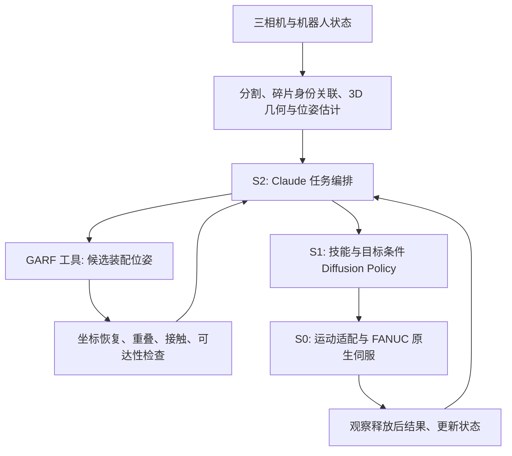

# Jing：双臂 CRAG 头骨装配

本分支以 Assembly Sim 为基础，目标是双 FANUC CRX-10iA/L + YAM 夹爪、左右腕部相机和第三视角相机，在 Isaac Sim 中装配至少六块 CRAG 头骨碎片，并用同源几何制造打印件、采集 Diffusion Policy 示范数据。

上游基线：`df03da2fc26a47d0dbf25782ec04fb6fc2ffc776`。

## 当前状态

**已完成真实数据、生产推理、扩大验证集的联合微调与 PhysX 稳定性对照；尚不是完整装配系统。** 最新验证集由 2 扩到 9 个独立头骨，排除参考接触异常后，以 7 个模型/6 标本训练。固定 5000 点、小片最低预算 20→200，最佳中心误差 38.05 mm；联合分类辅助损失改善旋转，但 72 个候选仍全部被几何筛选拒绝。24 秒仿真中求解器对照使稳定碎片由 6/8 增至 7/8。详细协议、限制和图像复现见 [本轮报告](reports/2026-10-18-ablation-v2/README.md)。YAM、打印拓扑和自主装配仍待完成。

CRX-10iA/L 是用户批准的临时型号，尚未核实捐赠实机。YAM 具体夹爪型号、资产、TCP、相机标定、真实控制选项均待确认。原始 CRAG 数据已从用户服务器取得，权重、数据及生成结果均存放于仓库外。

```bash
python3 -m tasks.dual_arm_crag_skull inspect
python3 -m tasks.dual_arm_crag_skull validate
python3 -m unittest discover -s tasks/dual_arm_crag_skull/tests
```

`validate` 成功只表示配置结构一致；输出明确报告 `simulator_ready: false`，不会启动机器人。配置中的空值必须被真实测量或验证结果替代，不能默认为零。

## S2 / S1 / S0 架构

| 层 | 选择 | 输入 | 输出 | 调度 |
|---|---|---|---|---|
| S2 | 用户指定 Claude Opus 5.5 | 三视角关键帧、可观测零件状态、CRAG 预测装配关系、执行反馈 | 结构化 skill request | 子任务结束、失败或重规划事件 |
| S1 | 条件 1D U-Net Diffusion Policy | 图像历史、双 TCP/开口状态、双手相对位姿、skill 与可观测目标 | 双臂末端动作块 | 滚动时域 |
| S0 | FANUC 原生伺服（实机）/ PhysX drives（仿真）+ 外部运动适配 | 动作块、机器人状态、碰撞环境 | 12 轴位置目标与两个夹爪宽度目标 | 初始仿真目标 60 Hz |
| 物理 | Isaac Sim / PhysX（已在 5.1 做场景 smoke） | 关节驱动、接触几何、质量和材料参数 | 实际运动与接触 | 初始 240 Hz |

S2 的显示名称保留为 `Claude Opus 5.5`，`api_model_id` 留空。该名称来自用户要求，不代表已经核实服务可用性；接入时核实供应商 API 标识，密钥用环境变量管理。没有发送邮件或私有资料给外部模型。

S2 不直接输出电机命令。请求必须通过 schema、目标可观测性、技能支持范围和 S0 可执行性检查。无模型服务时可用人工编排请求验证 S1/S0，不自动替换模型。

### S0 优先使用 FANUC 原生伺服

实机链路：S1 双 TCP 动作块 → 外部双臂协调、碰撞检查、IK 与时间参数化 → ROS 2 Scaled Joint Trajectory Controller → FANUC 官方驱动 → FANUC 控制器原生伺服。底层电机控制无需重写；YAM 夹爪需要独立驱动。两台控制器的同步和互相避碰仍须由本项目实现与验证。

Isaac Sim 使用 PhysX 关节位置驱动近似执行层，不等同于 FANUC 原厂伺服模型；需要通过延迟、跟踪误差和速度限制标定缩小差异。

按 [FANUC 官方 v2.3.0 文档](https://fanuc-corporation.github.io/fanuc_driver_doc/v2.3.0/docs/quick_start/quick_start.html)，实机外部控制要求 J519 Stream Motion + R912 Remote Motion，或包含两者的 S636 软件包；还须满足相应控制器固件版本。CRX-10iA/L 在官方 MoveIt 示例支持列表中，但捐赠设备的控制器、固件及选件尚未核实。官方驱动可用并不表示实机已具备许可证。

S1 负责学习多模态的抓取和装配动作，S0 负责确定性的运动执行。第一版用位置伺服，便于对齐 FANUC 实机能力；不假设支持直接力矩控制，也不默认加入未经标定的力控。

初始基线可复用阻尼最小二乘 IK，但必须增加限位、速度、步长和碰撞拒绝；它不是完整避障规划器。目标外部运动适配器使用 12 轴联合 QP：

`min ||J qdot - v_des||_W² + λ ||qdot||²`

约束包括关节位置/速度/加速度、左右臂和环境最小距离；距离约束为局部线性近似，执行前仍需连续碰撞检查。无可行解、轨迹过期或观测超时则拒绝动作并返回结构化状态，不静默裁剪成不同任务动作。停止时不能默认松开正在支撑的碎片。

S0 做局部跟踪，不能解决全局绕障。远距离搬运需要独立的碰撞感知路径规划接口；第一阶段两臂交替进入装配区，第二阶段再做一臂支撑、一臂插入。只有在传感器、驱动能力和接触模型完成验证后，才评估 Cartesian admittance/impedance。

## S1 训练设计

采用共享或独立视觉编码器提取三相机特征，将两帧观测历史、本体状态、左右工具相对位姿、技能 ID、目标条件编码作为 conditional U-Net1D 的条件。该技能/目标条件是本项目扩展，并非原始 DP 自动具备语义规划。

初始配置：观测历史 2 步、10 Hz 动作网格、预测 16 步、执行前 4 步后重新观测。1.6 秒预测、0.4 秒执行是待调参基线；相机/推理/控制延迟必须计入执行时间戳。接触阶段可缩短执行块。

每手 3 维相对平移 + 6D 旋转 + 1 维绝对开口宽度，共 20 维。所有未来位姿相对于本次观测时该手 TCP 固定锚点，不是相邻动作增量。先把 6D 旋转正交化，再合成 SE(3)，不能把无效旋转直接下发。动作表示细节见 [接口文档](INTERFACES.md)。

训练流程（待实现）：

1. 从 CRAG GT 与配置生成脚本专家请求；专家可使用真值定位。
2. 专家必须经过同一个 S0 和 PhysX 执行，记录成功及失败，不能直接搬动物体伪造抓取。
3. 保存三相机、实际 TCP/宽度、实际关节状态、请求/接受动作、时间戳和结果。
4. 按 episode 切分训练/验证/测试，先用完整成功示范训练；失败留作评估和以后恢复技能训练。
5. 对训练集统计归一化；用噪声预测损失 `E[||epsilon - epsilon_theta(A_k, k, observation)||²]` 训练 DP。
6. 在未见过的初始摆放上闭环评估，不仅看离线 loss；额外报告抓取、单块放置、整件装配成功率与碰撞/失败分类。

GT 物体位姿仅供专家/评估，默认不进入 S1/S2 的正式观测。可以做明确标注的 oracle 消融。随机目标必须通过标记、目标位姿条件或可观测几何表达，不能要求策略复现隐藏随机点。

## CRAG 与可打印几何

候选样本是原演示的八块 `Hoolock-hoolock-f-AMNH-83425-cranium-einscan`。必须实际读取后校验独立 fragment ID、数量、单位和场景节点变换，不根据文件名假定八块。GT 与 CRAG 预测分别保存；用 GT 制造/评估，用预测测试推理和纠错。

新增 loader 接入现有 `FragmentInput/AssemblyInput`；在统一装配坐标系缩放并共用体素网格，解决不同碎片体素所有权冲突。检查每片六邻域面连接、最小厚度、闭合流形、无自交和非零体积；仅角/边相接的 26 邻域连接不能证明可打印性。

从同一制造几何导出 3MF 或注明毫米单位的 STL、视觉网格和可验证的碰撞近似。整体缩放、体素间距和装配间隙依夹爪开口、打印工艺及测试样件选择，当前不猜值。不沿用蓝绿演示中任意 2 mm 碰撞体缩小或高摩擦参数作为实物参数。

体素化不保证拼接稳定或存在插入路径。需要验证装配顺序、夹爪退出空间、支撑状态；若使用底座/定位销/磁铁，应同时在 CAD、仿真和任务定义中表示。先打印配合试样，再打印整套。

## YAM / 三相机 / UMI

重构上游 Robotiq 固定路径与 mimic 逻辑为夹爪描述接口；YAM 模型确定后再实现安装变换、宽度-电机映射、接触模型、质量和驱动限值。腕相机相对工具的安装变换必须与 UMI 手持工具尽量一致，第三视角同时在 UMI 采集中录制。

UMI 是离线手持示范来源，不是 FANUC 控制驱动。使用 UMI SLAM/标定管线恢复相机轨迹、转换到 TCP，标定开口并统一双手坐标系；标记追踪失败、时钟偏移与不确定性。导入后进行双臂可达性和碰撞回放验证。UMI 没有关节角，不补造关节数据；公共策略接口使用 TCP 与开口，机器人关节数据作为可选诊断通道。

真实 FANUC 用独立适配器对接官方 ROS 2 驱动候选，核实控制器、软件选项、频率与时间同步后再定部署频率。仿真 60 Hz 不是对实机控制速率的承诺。

## 代码改动地图

| 现有模块 | 下一步 |
|---|---|
| `core/robots/{config,builder,controls,kinematics}.py` | 参数化夹爪、挂载/TCP、增加控制适配层 |
| `core/config/presets/dual_arm.json` | 复用结构；另存实测工作台标定，不覆盖默认值 |
| `core/workcell/cameras.py` | 三路同步采集与标定加载 |
| `tasks/dual_arm_breakingbad/domain/`、`preprocessing/` | 复用数据模型/统一体素网格，新增 CRAG loader |
| `tasks/stack_sawtooth_shulker_small/collection.py` | 参考录制逻辑，但重写为双臂、三相机、N 碎片与因果时间记录 |
| 本任务后续模块 | `s2/`, `s1/`, `s0/`, `data/`, `scene/`, `manufacturing/` |

完整验收顺序见 [TODO](TODO.md)。上游已发现 `Arm` 构造参数不一致、teleop/conditions 缺失引用，必须先复现并修复，不能假定旧脚本能直接运行。

## 参考

- [Diffusion Policy](https://diffusion-policy.cs.columbia.edu/)
- [UMI](https://github.com/real-stanford/universal_manipulation_interface)
- [I2RT 夹爪与驱动](https://github.com/i2rt-robotics/i2rt)
- [FANUC 官方驱动](https://github.com/FANUC-CORPORATION/fanuc_driver)
- [CRAG](https://github.com/ai4ce/CRAG)

## GARF 作为 S2 的装配推理工具

用户指定权重：[GARF.ckpt](https://drive.google.com/file/d/1ZN0-Y2HaVe6zI7q4xUVVvhbSqKGbORfg/view)，Drive 元数据大小 573,313,422 bytes。已下载、校验 SHA256，并在官方 CUDA 环境严格加载成功。配套代码参考 [ai4ce/GARF](https://github.com/ai4ce/GARF)，其官方评估使用 `denoiser_flow_matching` 和 `ckpt_path`。GARF 与 CRAG 是不同模型，不能把该权重直接加载到 CRAG 网络。

权重由独立 GPU 推理服务加载一次。S2 调用 `propose_assembly` 工具，不接收权重张量，也不直接调用电机。以下是本项目拟定的服务接口，并非声称 GARF 原生已有 API 或置信度输出；已实现本地 JSON-lines 推理进程，网络服务与 S2 API 编排尚待接入。



1. 感知输出稳定 fragment ID 和各碎片局部点云。三路 RGB 不会自动产生有尺度的完整 3D：第一阶段采用已知扫描模型 + 视觉位姿估计，或另行实现标定多视角重建。禁止把仿真 GT 偷渡为部署感知输入。
2. S2 在初始装配、身份/几何更新、装配失败时调用 GARF。请求包含 `observation_id`、输入几何哈希、fragment IDs、点云引用、米制单位、归一化变换、anchor ID、随机种子。相同输入可以缓存，视频每帧无需重复运行。
3. 工具负责官方采样/归一化与模型推理，返回候选 `assembly_T_fragment`、模型版本、checkpoint SHA256、输入哈希、延迟与失败状态。评分由明确的几何评估器计算；未经校准的评分不称为成功概率。多候选需要显式多次采样和记录 seed。
4. 固定锚点将模型装配坐标转换为工作台坐标。约定 `A_T_B` 把 B 坐标映射到 A，则 `world_T_assembly = world_T_anchor @ inverse(assembly_T_anchor)`，且 `world_T_fragment_goal = world_T_assembly @ assembly_T_fragment`。模型归一化尺度需先恢复，不能直接把归一化平移当米。
5. 几何检查器拒绝不合理穿透、ID 缺失和无效变换；规划器检查双臂可达性、抓取与插入路径。GARF 给出目标装配形状，不负责机器人路径或先后顺序。
6. S2 选择 `pick/place/align`、操作者手臂、支撑片和目标相对位姿。S1 根据技能/目标、图像与本体状态生成双手短动作块，S0 完成限位/碰撞检查与执行。S1 必须训练这些条件，不能把新技能名称直接塞入未经相应训练的策略。
7. 每次放下后重新感知，检查相对位姿与稳定性。通过则继续；失败则重观察、重调 GARF 或安排恢复动作。超时、异常、过期 observation ID 不产生运动命令。

训练时可用 GT 生成专家动作，但 S2/GARF 的预测与 GT 必须分开记录。数据记录 GARF 输入版本、候选、检查结果、S2 技能、S1 请求动作、S0 接受动作及执行后状态。分别评估 GT 目标、GARF 目标和 GARF+S2 恢复，才能区分几何误差与控制误差。

## 当前可执行的 CPU 准备和仿真入口

安装 `requirements-cpu.txt` 到独立 Python 3.12 环境。输入必须是各节点已经处于装配 GT 坐标的 GLB，至少六个节点。下面尺寸只是调用示例，不能视为已批准的打印参数：

```bash
python -m tasks.dual_arm_crag_skull prepare \
  --input /data/skull_assembled_gt.glb --output /data/jing_prepared \
  --pitch 0.005 --target-length 0.20 --source-is-assembled-gt
# 在具备项目所需 Isaac Sim 的环境内运行：
python -m tasks.dual_arm_crag_skull launch \
  --assembly /data/jing_prepared/layout.json --allow-robotiq-proxy
```

准备步骤保留节点变换与稳定 ID，复用共同网格和唯一体素归属，保留所有占据体素，拒绝非六邻域连通/非闭合/绕向不一致的碎片；输出布局、米制 NPZ 与毫米 STL，以及源文件哈希、坐标变换和单位 manifest。当前仍为表面采样体素，不是实体体素填充；间隙为零，薄壁、插入路径和制造试样尚未验证，STL 是几何候选。

`launch` 复用双 CRX、三相机、PhysX 碎片场景，显式要求允许 Robotiq 临时代替；不声称 YAM 已实现。当前只有人工交互入口，无自动六片装配专家。CPU 合成 GLB 测试不能代替真实头骨样本与 GPU 物理抓取验证。此前 Arm(dict) 风险描述属于历史待复核项，不能认定当前重构后的代码仍存在该错误。

## 运行 GARF tool 与 RGB-D 接口

已实现 `tools.garf.GarfTool`、Anthropic 风格 tool schema、JSON-lines runner；GPU 模型加载一次，支持单 seed 和 1–8 个 seed 候选。完整点云与法向量以 NPZ 注册，S2 只提交 ID，不能提交任意文件路径。输出候选不直接触发运动。

官方 GARF 依赖在独立目录执行 `uv sync --extra post`；固定源码 commit `2d489c0b7b58de8af774aa1657c86c638e4744c2`。权重 SHA256：`cc6512ab48818b902bc1a7a0b4c569e049dbd6633c62cfff3de0890715825e02`。使用严格 state_dict 匹配和受限 checkpoint 加载，只允许核对过的 OmegaConf 元数据类型。

```bash
python -m tasks.dual_arm_crag_skull.tools \
  --repository /data/GARF --checkpoint /data/GARF.ckpt \
  --geometry /data/points/registry.json \
  --mesh-registry /data/points/mesh_registry.json \
  --model-unit-m 0.20749005075939986 < /data/request.jsonl
```

注册表为 `{"part_0":"/data/part_0.npz", ...}`，NPZ 包含米制 `points: Nx3` 与 `normals: Nx3`。单行请求例子：

```json
{"tool_name":"propose_assembly_candidates","current_observation_id":"obs-10","request":{"observation_id":"obs-10","fragment_ids":["part_0","part_1"],"anchor_id":"part_0","seeds":[41,42,43,44]}}
```

`current_observation_id` 由编排器提供；S2 的 observation_id 不一致则拒绝。固定几何抽样，只改变初始噪声；默认 20 步、6 次迭代。大批推理仍应由外部进程施加超时与资源限制。

用户提供每个 part 的完整点云后，可以省去完整几何重建，但不能省去 RGB-D 中的实例识别和当前位姿估计。见 [接口文档](INTERFACES.md) 的反投影、ICP、锚点恢复公式，以及“已装好碎片融合为一个刚体”的逐步推理接口。

真实资产来源已定位到 maxwell 的 `data/fanuc_crag_skull_assembly/01_crag_case/view_gt.glb`，确认为八片 Hoolock 头骨。原 bundle README 明确旧影片是运动学 storyboard，不能当物理抓取验证。新的 `smoke.py` 在 Isaac Sim 5.1 执行物理步进并在暂停的同一时刻采集三路 RGB、光学 Z depth、内外参；仍不表示完成抓取装配。

```bash
python -m tasks.dual_arm_crag_skull prepare \
  --input /data/view_gt.glb --output /data/skull_diagnostic \
  --pitch .008 --target-length .2 --source-is-assembled-gt \
  --simulation-only --allow-disconnected-rigid-proxy
python -m tasks.dual_arm_crag_skull.smoke \
  --assembly /data/skull_diagnostic/layout.json --output /data/smoke \
  --allow-robotiq-proxy
```

该诊断模式保留所有体素，把不连通分量作为一个刚体近似，并明确写入 manifest；不导出 STL，不适合打印或装配验收。可选单格补桥保持全部原体素并避免侵占其他片，但在本次头骨上未解决全部断裂，因此没有用于上述运行。原 FANUC 资产还触发部分 link 的质量/惯量警告，动力学可信度须另行校准。

## 2026-10-14 实测结果

[机器可读报告](reports/2026-10-14.json) 记录八片真实头骨、权重哈希、四噪声候选和三相机数据。GPU 上固定几何采样，使用 20 步 × 6 次迭代：

| noise seed | 推理秒数（不含加载） | 非锚点平均平移误差 | 非锚点平均旋转误差 |
|---|---:|---:|---:|
| 41 | 3.57 | 58.9 mm | 101.3° |
| 42 | 2.28 | 46.6 mm | 124.4° |
| 43 | 2.16 | 47.8 mm | 118.9° |
| 44 | 1.77 | 57.6 mm | 123.7° |

误差用独立 GT 作锚点对齐，只用于离线评估。当前候选显著不足以直接装配；多噪声调用确实得到不同候选，但这四次结果没有证明精度足够。下一步应对齐官方数据预处理、检查法向/归一化、评估更大点数、多候选几何筛选及头骨域适配。不得把 oracle 最优候选作为部署成功率。

物理诊断场景已跑 120 次 world.step（约 4.05 s），三路 RGB-D 采样时间一致；这是场景/传感器 smoke test，尚无抓取或自动装配成功结果。

## GARF 官方流程审计与候选拒绝

详见 [2026-10-14 审计报告](reports/garf_audit/README.md)：官方预处理仍未恢复真实头骨；固定采样与密集采样均失败，坐标回代误差约 1e-8 m。官方瓶子对照能恢复多数碎片，但不能证明头骨精度达标。

`export_points` 现在额外输出同局部坐标的 PLY 和 `mesh_registry.json`；JSONL 工具加 `--mesh-registry PATH` 可执行不依赖 GT 的穿透/接触筛选。无合格候选时明确返回 `all_candidates_rejected`；几何评分不授权机器人运动。原有四个 noise 候选全部拒绝。理想两片合并实验也没有恢复剩余六片的装配精度，不能作为自动安装成功。

本轮另修复了多候选随机性混杂：PointTransformer 在 eval 模式仍随机打乱序列，且固定 seed 后重复编码也未保证相同指纹。现在同一批几何只编码一次，缓存按几何内容失效；四个候选已验证共享相同特征，平均位置误差仍约52–60 mm。该修复保证实验可比性，不代表头骨装配精度已解决。


## 2026-10-18：生产入口对齐与头骨特征诊断

默认 JSONL 入口现使用 `OfficialGarfBackend`，直接调用固定版本的官方 `MeshInferenceDataset`：总5000点、面积加权、最低20点、相同共同尺度/逐片旋转和归一化，不再在生产入口按点云密度重新抽样。显式固定采样RNG，并复用同一几何特征，保障多noise可比。旧近似入口仅可通过 `--legacy-preprocessing` 使用。

`--model-unit-m` 表示每个模型坐标单位对应多少米，必须来自输入标定或明确的实验尺度。上面的数值仅适用于本次最长边200 mm的头骨实验，不能套用于其他物体。`--mesh-registry` 是提供完整表面与面积的注册几何，必须与NPZ处于同一局部米制坐标；官方点云在服务端由该几何生成。只有无组织点云、没有面积/表面信息时，无法声称与官方mesh采样完全等价，默认入口会拒绝缺失元数据而不猜测。

断裂面几何代理诊断显示，瓶子召回率约99.9%，头骨约8.0%；头骨最大片召回率为0。该差异支持编码器对头骨断裂几何泛化不足，但分类掩码未直接参与当前位姿模型，不能把它当作唯一已确认根因。详见 [本轮报告](reports/2026-10-18/README.md)。
